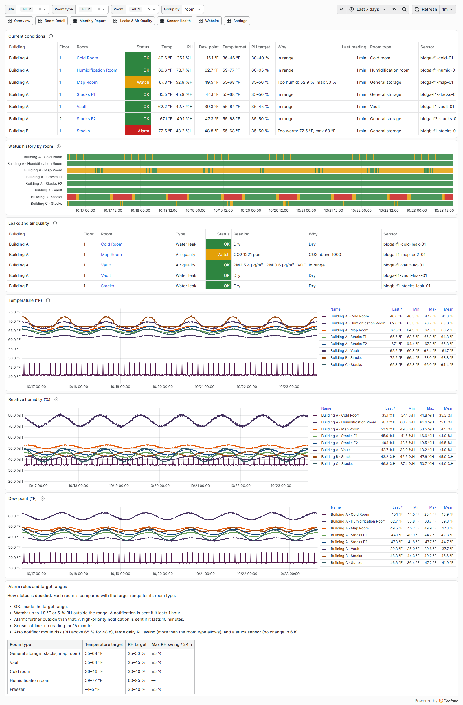
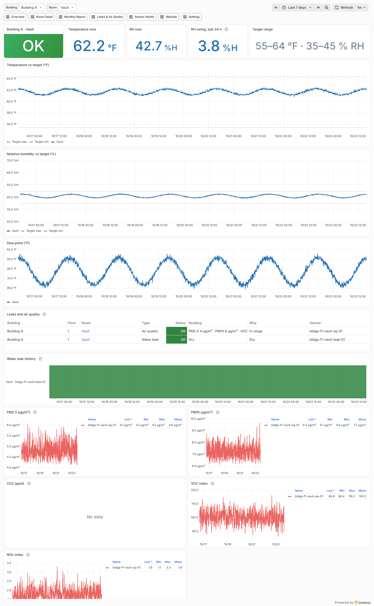
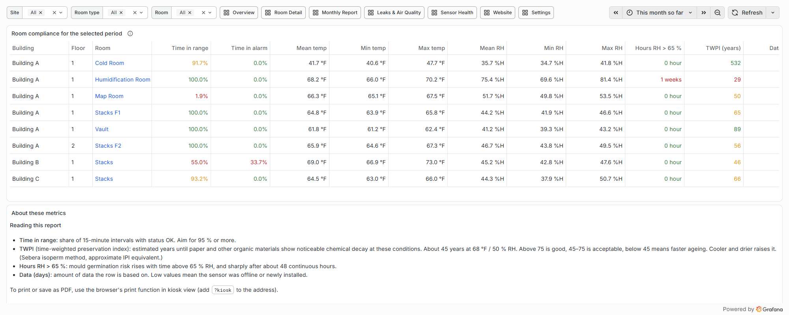
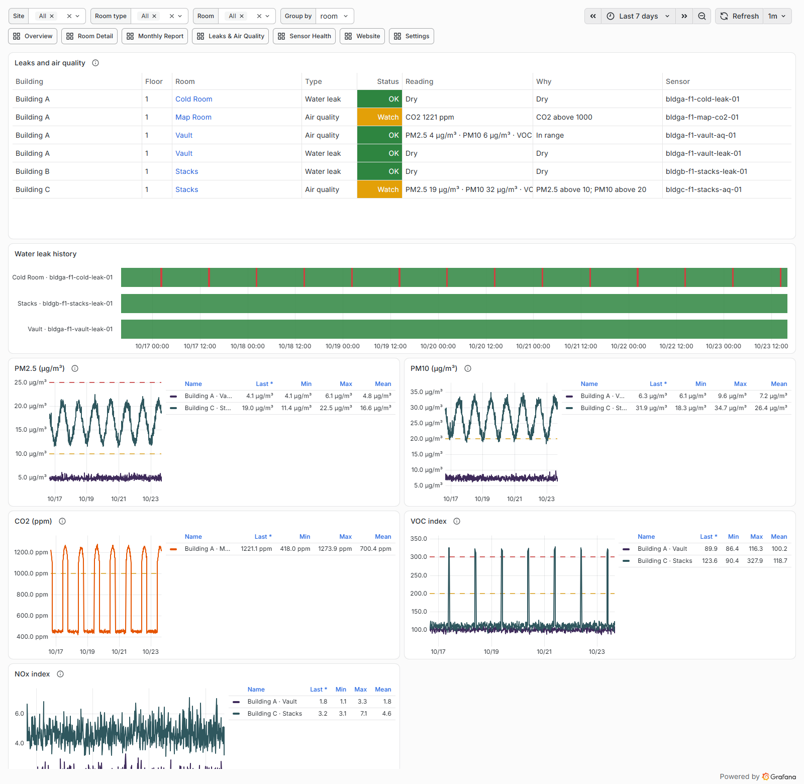
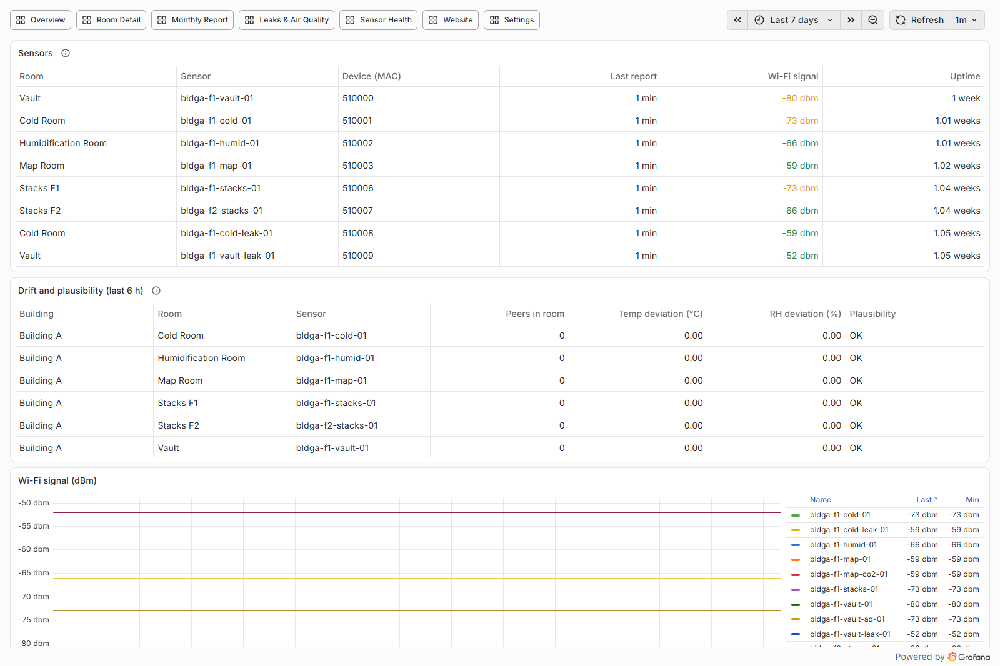
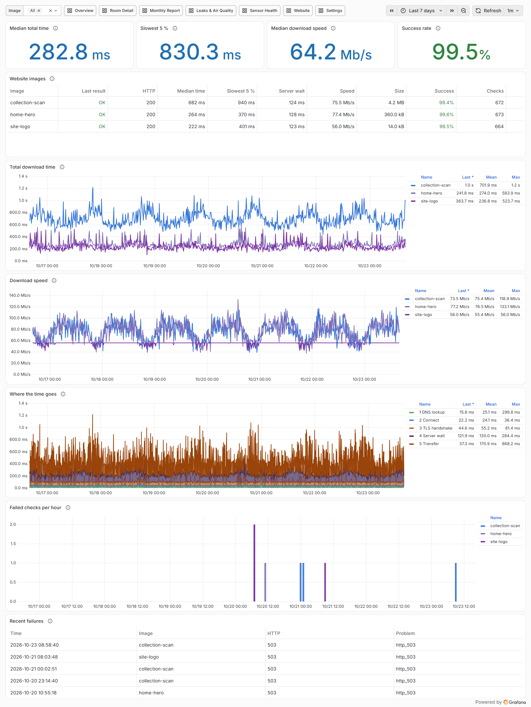

# Archives Conditions Monitor

Self-hosted monitoring for archive storage rooms. It measures temperature and relative humidity, compares each room
with archival targets and alerts staff by phone. It also handles water-leak probes, air quality (PM2.5/PM10, CO2,
VOC, NOx) and the download speed of images on the organisation's website.

It is a Docker Compose stack (MQTT + Telegraf + InfluxDB + Grafana, the "TIG" stack) and runs on any 64-bit Linux
machine: a small PC, a VM or a single-board computer. The reference install is a Raspberry Pi 5 with 2 GB RAM.

History: [CHANGELOG.md](CHANGELOG.md).

## Screenshots

Simulated sensors in example buildings (the built-in simulator), not a real site.

**Overview**: current status of every room, status history, temperature / RH / dew point trends, and the alarm rules.


<details><summary><b>Room Detail</b>: one room against its target band, 24 h RH swing, leak and air-quality sensors</summary>


</details>

<details><summary><b>Monthly Report</b>: time in range, time in alarm, extremes, preservation index (TWPI), mould-risk hours</summary>


</details>

<details><summary><b>Leaks &amp; Air Quality</b>: leak probe history, particles, CO2, VOC and NOx with watch/alarm limits</summary>


</details>

<details><summary><b>Sensor Health</b>: last report, Wi-Fi signal, uptime, drift between sensors in the same room, stuck-sensor checks</summary>


</details>

<details><summary><b>Website</b>: image download time, speed, where the time goes (DNS, connect, TLS, server, transfer) and failures</summary>


</details>

## The stack

All services run as containers from `docker-compose.yml`. Image versions are pinned; change them deliberately.

| Service | Image | Role | Port |
| --- | --- | --- | --- |
| mosquitto | `eclipse-mosquitto:2.0.22` | MQTT broker; sensors publish here (login + ACL) | 1883, LAN |
| telegraf | `telegraf:1.40.2` | Reads MQTT, adds room/targets from the registry, calibrates, computes dew point and status | internal |
| influxdb | `influxdb:2.7.12` | Time-series storage: raw data 2 years, 15-minute rollup kept forever | 8086, host only |
| grafana | `grafana/grafana:13.2.4` + Business Forms 6.3.5 plugin | Dashboards and alert rules | via proxy |
| proxy | `nginx:1.30.6-alpine` | Front door for Grafana and the target editor (place for TLS) | 3000, LAN |
| config | `python:3.12.7-slim-bookworm` | API for the Settings dashboard: target ranges, software-update requests | internal |
| ntfy | `binwiederhier/ntfy:v2.31.1` | Self-hosted push notifications to staff phones | 8090, LAN |
| webmon | `python:3.12.7-slim-bookworm` | Website image download checks | internal |
| simulator | `python:3.12.7-slim-bookworm` | Fake sensors for demos (only with `--profile sim`) | internal |

The Python services use only the standard library, so no packages are installed. Dashboards and alert rules are
generated by `scripts/build_dashboards.py`.

**Sensors:** any [Tasmota](https://tasmota.github.io/) device reporting over MQTT. Tested with the IoTorero ST01
(ESP32-C3, SHT40). Leak probes report as `Switch1`; SEN5X, SCD40, PMS5003 and SGP30 readings count as air quality.

## Requirements

- **OS:** 64-bit Linux, amd64 or arm64 (every image is multi-arch). Tested on Debian 13; Ubuntu and other
  distributions work if you install Docker yourself. The optional hardening script assumes Debian/Ubuntu (`apt`).
- **Docker:** Docker Engine with the Compose plugin (`docker compose`), or the older `docker-compose`.
- **Memory:** 2 GB minimum (the stack uses about 1 GB), 4 GB comfortable.
- **Disk:** a rough estimate is 1–2 GB of InfluxDB data for 20 sensors over two years, plus about 3 GB of images.
  Prefer an SSD; SD cards wear out under database writes.
- **Network:** a fixed LAN address (DHCP reservation), because sensors are configured with it. Sensors and staff
  devices must reach ports 1883, 3000 and 8090. Outbound internet is needed for image pulls, the Grafana plugin
  download on first start, and the website monitor.
- **Host tools:** `bash`, `openssl`, `curl`, `git`, and `python3` to generate dashboards (or run that step in Docker,
  see step 5).

## Install

Commands run on the server as a normal user. Use `/opt/archmon` as the folder: the scripts work from any folder,
but Docker names the data volumes after it (`archmon_grafana-data` and so on), and the backup notes assume it.

### 1. Prepare the host

**Debian / Ubuntu (recommended):** `scripts/bootstrap.sh` installs Docker and hardens the machine. It upgrades
packages, installs Docker from the distribution, turns on unattended security upgrades and fail2ban, allows SSH
only from your LAN (ufw), blocks root SSH login, and limits the published ports 1883/3000/8090 to your LAN. That
last part matters because Docker-published ports bypass ufw. It also adds your user to the `docker` group and
creates `/opt/archmon`.
```
sudo apt-get install -y git
git clone https://github.com/guywire/archives-conditions-monitor.git /tmp/acm
sudo LAN_CIDR=192.168.1.0/24 bash /tmp/acm/scripts/bootstrap.sh "$USER"    # your staff/sensor subnet
```
Log out and back in so the `docker` group applies.

**Other distributions:** install Docker Engine and the Compose plugin ([docs.docker.com/engine/install](https://docs.docker.com/engine/install/)),
add your user to the `docker` group, create the folder with `sudo install -d -o "$USER" -g "$USER" /opt/archmon`, and
firewall ports 1883/3000/8090 to your LAN yourself (with firewalld or nftables, add the rules in the `DOCKER-USER` chain).

### 2. Get the code
```
git clone https://github.com/guywire/archives-conditions-monitor.git /opt/archmon
cd /opt/archmon
```

### 3. Generate secrets
```
scripts/gen-secrets.sh            # writes .env (mode 600) with random passwords and tokens
```
Then edit `.env` and set `NTFY_BASE_URL=http://<server-address>:8090`. `.env` never leaves the server and is
git-ignored. Back it up together with the data (see Backups).

### 4. Describe your site
The registry files hold your real rooms, so they are git-ignored. Start from the templates:
```
for f in sensors room_profiles room_overrides web_targets; do cp registry/$f.example.csv registry/$f.csv; done
```
- `registry/sensors.csv`: one row per sensor: `sensor_id`, site, building, floor, room, `room_type`, calibration
  offsets `cal_t` (°C) and `cal_rh` (%RH), install date, and `kind` (blank, or `motion` for a motion sensor).
- `registry/room_profiles.csv`: target band per room type, in °C and %RH. The template holds archival defaults
  (general storage, vault, cold room, humidification room, freezer); the Settings dashboard edits it later.
- `registry/web_targets.csv`: website images to time. Leave it empty to turn the website monitor off.

### 5. Generate the dashboards
```
python3 scripts/build_dashboards.py
# without Python on the host:
docker run --rm -u "$(id -u)" -v "$PWD:/w" -w /w python:3.12.7-slim-bookworm python scripts/build_dashboards.py
```
The dashboards and alert rules are generated from your room list and are not stored in Git, so this step is
required. Re-run it after editing rooms (the updater and the Settings dashboard do it automatically).

### 6. Start the stack
```
scripts/setup-stack.sh
```
This creates the hashed MQTT logins (`telegraf`, `sensor`, `admin`), starts InfluxDB, creates the buckets, and
writes least-privilege tokens into `.env`: Telegraf can only write, Grafana can only read. Then it starts everything.

### 7. Create the 15-minute rollup task
```
set -a; . ./.env; set +a
docker cp influxdb/rollup_15m.flux archmon-influxdb:/tmp/rollup_15m.flux
docker exec archmon-influxdb influx task create --org "$INFLUX_ORG" --token "$INFLUX_ADMIN_TOKEN" -f /tmp/rollup_15m.flux
```

### 8. Create staff logins
```
scripts/setup-grafana-users.sh    # read-only Grafana login "staff"
scripts/setup-ntfy.sh             # ntfy users: admin, grafana (publishes alerts), staff (receives alerts)
```

### 9. Turn on updates from Grafana (optional)
See [Software updates](#software-updates). It needs your release-signing public key:
`sudo scripts/setup-updater.sh "$USER" <your-email> <signing-key.pub>`

### 10. Schedule backups
`crontab -e`, then add: `20 2 * * * /opt/archmon/scripts/backup.sh >> /opt/archmon/backups/backup.log 2>&1`

### 11. Check
`docker compose ps` should list every service as running. Open `http://<server-address>:3000` and log in as `admin`
(`grep GRAFANA_ADMIN_PASSWORD .env`). To see data before real sensors arrive, start the simulator (see Common tasks).

### 12. Connect sensors
1. Join the Tasmota sensor to Wi-Fi (its setup hotspot) and set MQTT: host `<server-address>`, port 1883, user
   `sensor` (`grep MQTT_SENSOR .env`), topic `<sensor_id>_%06X`, e.g. `bldga-f1-vault-01_%06X`.
   Telegraf splits the MAC suffix off into `device_id`.
2. Give that `sensor_id` a row in `registry/sensors.csv`.
3. ST01 only: `scripts/setup-sensor.sh <full topic>` (e.g. `bldga-f1-vault-01_A1B2C3`) applies the SHT40 template,
   60 s reporting, the LED and a web password. Other Tasmota devices need their own template, plus `SetOption8 0`
   so they report °C.
4. `docker restart archmon-telegraf` if you changed the registry.

## Everyday use

`<server-address>` is the server's fixed LAN address.

| What | Where |
| --- | --- |
| Dashboards | http://<server-address>:3000 (login `staff`, read-only) |
| Wall screen / no menus | http://<server-address>:3000/d/archmon-overview?kiosk&refresh=1m |
| Monthly report | Dashboards → 3 Monthly Report (defaults to this month so far; time picker → "Previous month" for a finished month; print from kiosk view) |
| Change targets | Dashboards → 7 Settings (Editors/Admins) |
| Phone alerts | ntfy app → server `http://<server-address>:8090`, user `staff`, topic `archmon-alerts` (site network only) |

Passwords are never stored in the repository. They live only on the server in `/opt/archmon/.env`, readable by the
admin user only. Look them up with: `grep -E 'GRAFANA_STAFF|NTFY_STAFF|TASMOTA_WEB' /opt/archmon/.env`

## How data flows

Sensor (Tasmota, MQTT topic `<sensor_id>_<MAC>`) → Mosquitto → Telegraf (adds room from `registry/sensors.csv`,
target band from `registry/room_profiles.csv`, calibration, dew point, status 0/1/2) → InfluxDB (`environment_raw`, 2 years;
`environment_rollup`, 15-min, forever) → Grafana dashboards and alert rules → ntfy push.

Data is stored in °C; dashboards and alerts show °F.

## Common tasks

Commands run on the server in `/opt/archmon` unless noted.

### Calibrate a sensor
Calibration offsets live in **one place**: `cal_t` (°C) and `cal_rh` (%RH) in `registry/sensors.csv`. Telegraf adds
them (`telegraf/normalize.star`) before data is stored. Do not also set Tasmota's `TempOffset`/`HumOffset` on the
sensor, or the correction is applied twice. Offset = reference − sensor reading, in °C (multiply a °F difference by
5/9). Only new readings change; history is not rewritten.

### Move a sensor to another room
Change its Tasmota topic (MQTT command `Topic <new_id>_%06X`) or edit its row in `registry/sensors.csv`, then restart Telegraf.

### Change target ranges (what counts as Watch/Alarm)
Grafana → **7 Settings** (Grafana Editors/Admins only). Edit a room type's range, or give one room an override
(blank = room-type value), then **Save targets**. Changes apply within about a minute, and every change is logged
with the user name in `registry/targets-changes.log`.

How it works: nginx (`proxy/`) serves Grafana and the editor API (`config/targets_api.py`, at `/archmon-api/`) on
port 3000. The API checks the user's Grafana session and writes `registry/room_profiles.csv` / `room_overrides.csv`
(°C). Telegraf then reloads itself (`--watch-config`). Watch/Alarm margins are in `telegraf/normalize.star`; alert
delays are in `scripts/build_dashboards.py` → `alerting()`.

### Simulated sensors (demo / testing)
`docker compose --profile sim up -d simulator` starts 14 fake sensors (`sim/simulator.py`): temperature/RH for 6
rooms, 3 water-leak probes, 3 air-quality sensors (SEN55 particles/VOC/NOx, SCD40 CO2) and 2 motion sensors. They appear in rooms
named "… (sim)", and their alerts go to the ntfy topic `archmon-sim` (subscribe with the ntfy admin login), never
to staff. Built-in scenarios:
- map room humid (Watch)
- Building B too warm in the afternoon (Alarm)
- cold-room door openings
- Building C dusty, with a daily VOC spike
- cold-room leak for 20 min every 12 h

Remove everything with `scripts/sim-clean.sh` (stops it and deletes all `sim-*` data).

### Leak and air-quality sensors
Tasmota payloads are recognised automatically: `Switch1` ON = water (leak probe on a switch input), and SEN5X, SCD40,
PMS5003 or SGP30 readings become an `air_quality` record. Limits are `AQ_LIMITS` in `telegraf/normalize.star`
(the dashboards read them from there). See the "Leaks & Air Quality" dashboard.

### Motion / presence sensors
Shows when someone is in a room, which explains short temperature/RH bumps (a person adds about 100 W and 40–70 g of
water vapour an hour). Hardware: any ESP32 or ESP8266 running Tasmota with a PIR sensor (AM312, HC-SR501) or the OUT
pin of an mmWave radar (HLK-LD2410, which also sees people sitting still) on one GPIO. Set the PIR's hold time to
about a minute.
1. Flash Tasmota, join Wi-Fi and set MQTT as for any sensor (Install, step 12), topic e.g. `bldga-f1-map-pir-01_%06X`.
2. `scripts/setup-motion.sh <full topic> <gpio>` sets the GPIO as Switch1 and adds a rule that reports every change at
   once plus the state every minute (heartbeat for the offline alert). Not yet tested on real hardware: watch
   `tele/<topic>/SENSOR` with `mosquitto_sub` afterwards.
3. Add the sensor to `registry/sensors.csv` with `kind` = `motion`. Without it, Switch1 is read as a leak probe.

Presence shows as a timeline on Room Detail and on Leaks & Air Quality. The simulator includes two motion sensors.

### Change sensor Wi-Fi
Add `WIFI_SSID=` and `WIFI_PASSWORD=` to `.env`, then run `scripts/sensor-wifi.sh switch all`. The new network goes
in slot 2 and the old one stays as fallback. To point sensors at a new server address as well:
`scripts/sensor-wifi.sh move all <new-address>`.

### Website monitor (image download speed)
The `archmon-webmon` container downloads the images listed in `registry/web_targets.csv` at randomised times, one
at a time. Each row gives a name, URL, average minutes between checks, ± jitter % and cache_bust. For every check
it records DNS, connect, TLS, server-wait and transfer times, plus size, speed and failures. See Grafana →
**6 Website**. Edits to the CSV apply within 30 s; logs: `docker logs archmon-webmon`.

Include at least one large image (1 MB+): small files finish before a connection reaches full speed, so their
Mbit/s is not meaningful. Results describe your own internet link as much as the website, so compare with a check
from elsewhere before blaming the web host. The "Website check failing" alert (ntfy, normal priority) fires when
fewer than half of an image's checks succeeded in the last 45 minutes.

## Software updates

New versions are installed from **signed** Git release tags, from Grafana → **7 Settings → Software update**
(Grafana Admins only), or from the command line. The server checks for a new release every night and sends an ntfy
note when one is available.

How it works: the Settings panel only asks; the config API writes `state/update-request.json`. A systemd unit on the
host sees it and runs `scripts/update.sh` as the admin user. No container has Docker or Git access. The updater:
1. verifies the tag is signed by a key in `state/allowed_signers` (unsigned or wrongly signed releases are refused)
2. refuses if tracked files were edited locally
3. runs `scripts/backup.sh`, checks out the tag, regenerates dashboards, pulls images and restarts the stack
4. waits up to 5 minutes for every service, Grafana, InfluxDB and fresh sensor data
5. if that fails, goes back to the previous version the same way and reports "rolled back"

Progress, history and the log show on the Settings panel; results also go to ntfy. Site files (`.env`, registry,
`state/`, backups) are git-ignored, so an update never changes them.

**One-time setup, maintainer's PC** (Git 2.34 or newer): a key used only for signing releases.
```
ssh-keygen -t ed25519 -f ~/.ssh/archmon_signing -C "archmon release signing"
git config gpg.format ssh
git config user.signingkey ~/.ssh/archmon_signing.pub
```
Optionally add the public key to GitHub as a *signing* key so releases show "Verified".

**One-time setup, server** (copy `archmon_signing.pub` there first; the email must match your Git `user.email`):
```
sudo scripts/setup-updater.sh "$USER" you@example.org ~/archmon_signing.pub
```
An install that was copied over instead of cloned is converted first, keeping all site files:
`scripts/convert-to-git.sh https://github.com/guywire/archives-conditions-monitor.git v0.9.0` (dry run, lists what
changes), then the same with `--apply`.

**Publishing a release:** add a `## X.Y.Z — date` section to CHANGELOG.md (it is shown in Grafana), commit, then
```
git tag -s vX.Y.Z -m "vX.Y.Z" && git push origin main vX.Y.Z
gh release create vX.Y.Z --verify-tag --title "vX.Y.Z" --notes "..."
```

**Command line:** `scripts/update.sh check`, `scripts/update.sh apply vX.Y.Z`. Without the updater:
`git pull && python3 scripts/build_dashboards.py && docker compose up -d && docker compose restart`.
Dashboards and alert rules are generated: edit `scripts/build_dashboards.py`, not the JSON/YAML.

### Backups and restore
`scripts/backup.sh` writes `backups/archmon-<date>.tar.gz` (14 kept). It contains InfluxDB, the Grafana and ntfy
databases, config and `.env`, so protect it. Set `BACKUP_DEST=/path/to/mounted/share` in `.env` for an off-machine
copy. Restore onto a fresh server:
1. Steps 1–2 of Install, then unpack `config.tar.gz` from the backup into `/opt/archmon` (brings back `.env` and
   the registry).
2. `scripts/setup-stack.sh` (recreates the MQTT users from `.env`), then restore InfluxDB:
   `docker cp influxdb archmon-influxdb:/tmp/restore && docker exec archmon-influxdb influx restore /tmp/restore --full --token <INFLUX_ADMIN_TOKEN from .env>`
3. Copy `grafana.db` into the `archmon_grafana-data` volume and `ntfy-user.db` into `archmon_ntfy-lib`, then
   `docker compose up -d`.

If the new server has a different address, update `NTFY_BASE_URL` in `.env` and point the sensors' MqttHost at it.

## Raspberry Pi notes
- Use 64-bit Raspberry Pi OS (Debian 13 tested). An NVMe SSD HAT is strongly preferred over the SD card.
- The Pi kernel has the memory cgroup off, so the containers' `mem_limit` values are ignored. To enforce them, add
  `cgroup_enable=memory` to `/boot/firmware/cmdline.txt`.
- Wi-Fi-connected hosts (NetworkManager): `sudo scripts/pi-wifi.sh` joins the network in `.env` (`WIFI_SSID`,
  `WIFI_PASSWORD`). It also makes the firewall follow the host's private subnet (`/etc/archmon/lan-cidrs`), so a
  network move doesn't lock you out.
- On the Pi 5's 5 GHz radio, connections were rejected (assoc-reject); a 2.4 GHz network with PMF off worked.

## Security notes
- No default passwords; every secret is generated on the server. Published ports are reachable from the LAN only
  (ufw + `DOCKER-USER` rules from `bootstrap.sh`), and InfluxDB only from the server itself.
- MQTT requires a login, and sensors may only publish telemetry. ntfy denies anonymous access.
- Grafana staff accounts are read-only. The target editor requires a Grafana Editor/Admin session and refuses
  cross-origin requests. Tasmota web pages require the `admin` login.
- MQTT and HTTP are unencrypted on the LAN. Add TLS (MQTT 8883, HTTPS in `proxy/nginx.conf`) if the network is shared.
